# RAPPORT DE CONCEPTION & D'ARCHITECTURE — PARTIE 1
## Projet AtelierCampus : Gestion Sécurisée des Inscriptions aux Ateliers de Cybersécurité

**Établissement :** Université Centrale  
**Cursus :** 2<sup>e</sup> année du Cycle Ingénieur en Cyber Security  
**Matière :** Développement JEE  
**Enseignant responsable :** Dr Riadh BOUSLIMI  
**Date de remise :** Novembre 2026  
**Livrable :** Projet de DS — Partie 1 : *Concevoir et présenter*  

---

## Sommaire

1. [Introduction et Contexte du Projet](#1-introduction-et-contexte-du-projet)
2. [Acteurs et Cas d'Utilisation](#2-acteurs-et-cas-dutilisation)
3. [Modèle de Données Métier & Implémentation en Mémoire](#3-modèle-de-données-métier--implémentation-en-mémoire)
4. [Parcours HTTP & Architecture MVC](#4-parcours-http--architecture-mvc)
5. [Analyse des Menaces de Sécurité & Contre-Mesures](#5-analyse-des-menaces-de-sécurité--contre-mesures)
   - 5.1 Menace 1 : Injection SQL
   - 5.2 Menace 2 : Cross-Site Scripting (XSS)
   - 5.3 Menace 3 : Accès Non Autorisé & Divulgation d'Informations
6. [Fiche de Vérification & Preuves de Tests](#6-fiche-de-vérification--preuves-de-tests)
7. [Dossier des Captures d'Écran Commentées](#7-dossier-des-captures-décran-commentées)
8. [Conclusion & Perspectives vers la Partie 2](#8-conclusion--perspectives-vers-la-partie-2)

---

## 1. Introduction et Contexte du Projet

Dans le cadre du cycle de formation des ingénieurs en cybersécurité de l'**Université Centrale**, des ateliers pratiques de perfectionnement technique sont régulièrement organisés (sécurité web OWASP, investigation numérique forensique, cryptographie et tests d'intrusion réseau). 

L'objectif du projet **AtelierCampus** est de concevoir et réaliser une plateforme web d'entreprise dédiée à la consultation de ces ateliers et à l'enregistrement sécurisé des demandes d'inscription.

Conformément au cahier des charges pédagogique du Dr Riadh Bouslimi, ce projet s'articule en trois versions incrémentales :
- **Partie 1 (Version actuelle) :** Conception, présentation ergonomique, architecture MVC, formulaires HTML/JSP, Expression Language (EL), factorisation des vues, stockage centralisé en mémoire via les Collections Java, validation stricte côté serveur et neutralisation des menaces web de base. Aucune base de données n'est connectée à ce stade.
- **Partie 2 :** Introduction des Servlets de contrôle avancés, persistance relationnelle avec JDBC, transactions ACID et mise en œuvre des rôles avec authentification.
- **Partie 3 :** Migration vers le framework Spring Boot / Spring Security et persistance avec Jakarta Persistence API (JPA / Hibernate).

Ce rapport présente l'analyse de conception, la modélisation, le parcours HTTP, l'étude formelle des menaces de sécurité et la validation technique de la **Partie 1**.

---

## 2. Acteurs et Cas d'Utilisation

### 2.1 Identification des Acteurs

L'application identifie deux acteurs principaux au sein du système global :

1. **L'Étudiant (Utilisateur principal en Partie 1) :**
   - Rôle public / apprenant souhaitant développer ses compétences pratiques.
   - Consulte la page d'accueil et le catalogue des ateliers disponibles.
   - Examine le programme pédagogique, l'intervenant, la date et la capacité d'un atelier.
   - Formule une demande d'inscription via un formulaire dédié.
   - Reçoit une confirmation claire indiquant la validation serveur et la nature simulée de l'opération en Partie 1.

2. **Le Gestionnaire (Rôle d'administration — conçu en P1, implémenté en P2) :**
   - Responsable pédagogique ou administrateur du département de cybersécurité.
   - Prépare et programme les ateliers (titre, intervenant, date, salle, capacité maximale).
   - Suit la liste des inscrits et supervise l'état d'occupation des sessions.
   - En Partie 1, les données du gestionnaire sont préconfigurées sous forme de jeux de données de référence en mémoire. L'authentification et les interfaces d'administration seront activées en Partie 2.

### 2.2 Diagramme des Cas d'Utilisation

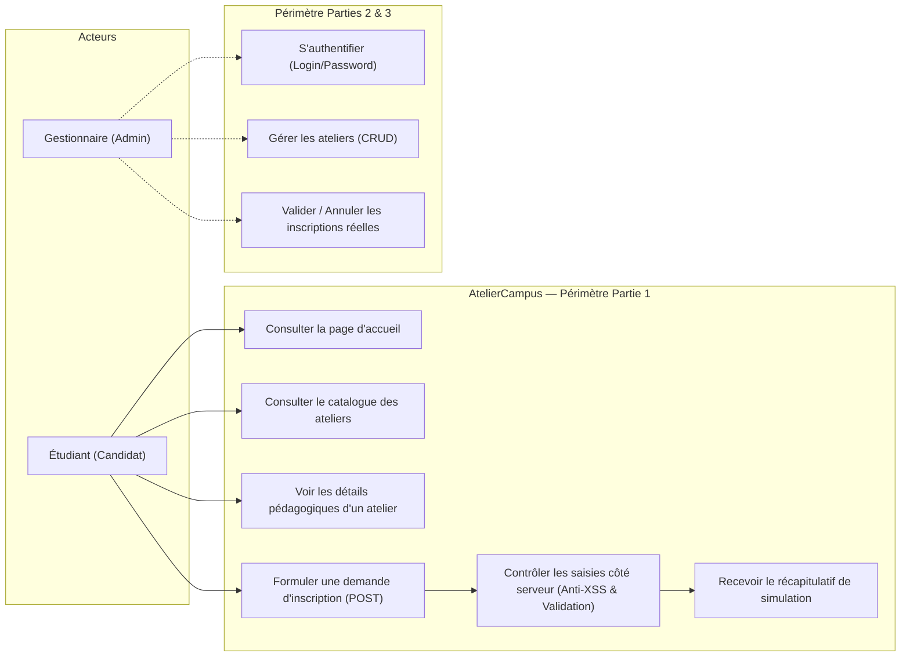

---

## 3. Modèle de Données Métier & Implémentation en Mémoire

### 3.1 Description des Entités du Modèle Minimal Commun

Le modèle minimal commun imposé par le sujet se compose de trois entités fondamentales :

| Entité | Attributs Obligatoires | Contraintes Métier |
| :--- | :--- | :--- |
| **`Etudiant`** | `id`, `nom`, `email` | `nom` non vide (2 à 100 car.), `email` au format valide RFC et unique dans le référentiel. |
| **`Atelier`** | `id`, `titre`, `descriptionCourte`, `description`, `dateHeure`, `capacite`, `animateur`, `salle`, `niveau` | `capacite` strictement positive (> 0). Calcul des statuts : disponible, complet, ou session passée. |
| **`Inscription`**| `id`, `etudiant`, `atelier`, `dateInscription`, `statut` | Statut parmi `CONFIRMEE` ou `ANNULEE`. Unicité stricte du couple `(étudiant, atelier)`. |

### 3.2 Diagramme de Classes UML (Modèle Métier)

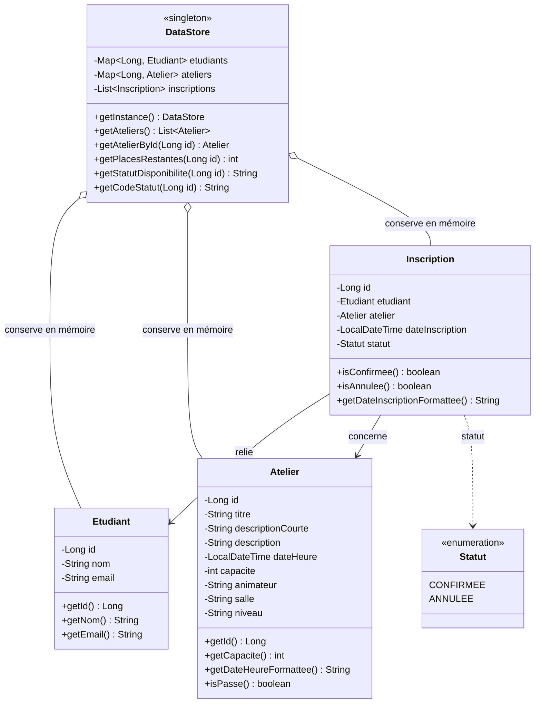

### 3.3 Données de Référence Initialisées en Mémoire (`DataStore.java`)

Pour répondre exactement aux exigences du cahier des charges, `DataStore.java` implémente un patron Singleton thread-safe utilisant des collections concurrentes (`ConcurrentHashMap` et `Collections.synchronizedList`) sans aucune connexion de base de données :

1. **Les 5 étudiants fictifs requis :**
   - Ahmed Ben Ali — `ahmed@gmail.com` (ID: 1)
   - Mohamed Trabelsi — `mohamed@gmail.com` (ID: 2)
   - Sami Mansour — `sami@gmail.com` (ID: 3)
   - Youssef Amri — `youssef@gmail.com` (ID: 4)
   - Karim Saidi — `karim@gmail.com` (ID: 5)

2. **Les 4 ateliers couvrant l'ensemble des situations requises :**
   - **Atelier #1 — Sécurité Web & OWASP Top 10 :** *Atelier futur disponible* (Capacité: 25 places, 1 inscrit confirmé, 24 places restantes).
   - **Atelier #2 — Analyse Forensique et Réponse à Incident :** *Autre atelier futur disponible* (Capacité: 20 places, 0 inscrit, 20 places restantes).
   - **Atelier #3 — Cryptographie Appliquée et Blockchain :** *Atelier futur complet* (Capacité: 3 places, 3 inscriptions confirmées pour Sami Mansour, Youssef Amri et Karim Saidi).
   - **Atelier #4 — Audit de Sécurité Réseau & Pentesting :** *Atelier déjà commencé / session passée* (Programmé au 15 octobre 2026).

3. **Inscriptions de référence :**
   - Unicité vérifiée de chaque couple `(étudiant, atelier)`.
   - Inscriptions confirmées (`CONFIRMEE`).
   - Présence d'au moins une inscription annulée (`ANNULEE` : Inscription #2 de Mohamed Trabelsi sur l'Atelier #1).

---

## 4. Parcours HTTP & Architecture MVC

### 4.1 Modèle d'Architecture MVC sous Jakarta EE 10

Le projet suit le patron **Modèle - Vue - Contrôleur (MVC)** afin de garantir une séparation stricte des responsabilités :
- **Modèle (`com.ateliercampus.model` & `com.ateliercampus.data`) :** Classes Java pures (POJO) et le singleton `DataStore`.
- **Contrôleur (`com.ateliercampus.web.TraitementServlet`) :** Réceptionne la requête HTTP POST `/traitement`, orchestre la validation via `ValidationUtil`, peuple les attributs de requête et délègue l'affichage.
- **Vue (Pages JSP & JSTL) :** Rendu HTML dynamique et sécurisé via Expression Language (`${...}`) et balises JSTL, sans scriptlets Java.

### 4.2 Diagramme de Séquence du Parcours HTTP

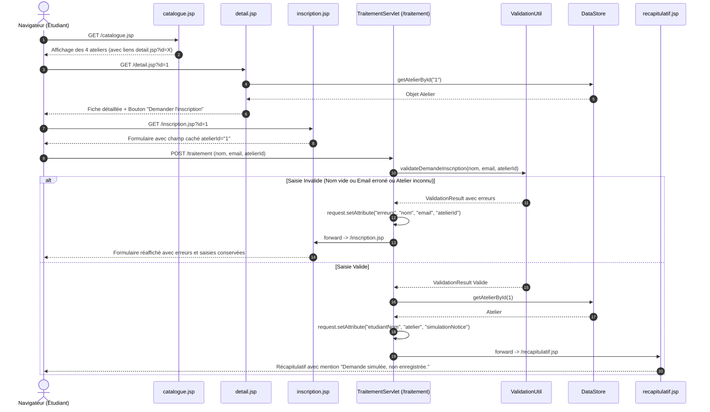

### 4.3 Préservation de l'Identifiant de l'Atelier

Tout au long du parcours HTTP, l'identifiant de l'atelier sélectionné est rigoureusement transmis :
1. Du catalogue vers le détail via paramètre GET : `detail.jsp?id=1`.
2. Du détail vers le formulaire via paramètre GET : `inscription.jsp?id=1`.
3. Du formulaire vers le composant de traitement via champ caché POST : `<input type="hidden" name="atelierId" value="1" />`.
4. En cas d'erreur de validation, le contrôleur conserve `atelierId` en attribut de requête pour réinjecter sa valeur dans le champ caché lors du réaffichage.

---

## 5. Analyse des Menaces de Sécurité & Contre-Mesures

Dans le cadre d'une application web d'inscription, trois menaces de sécurité critiques ont été analysées et traitées :

### 5.1 Menace 1 : Injection SQL

#### A. Description & Vecteur d'Attaque
L'injection SQL se produit lorsqu'une entrée utilisateur non filtrée est directement concaténée dans une commande SQL exécutée par la base de données (ex: `nom = 'John' OR '1'='1'`). Un attaquant peut ainsi contourner les contrôles, dérober des données sensibles ou altérer la base.

#### B. Statut en Partie 1
En Partie 1, **aucune base de données relationnelle n'est connectée**. Toutes les données sont gérées en mémoire dans des collections Java typées (`Map<Long, Atelier>`, etc.). La menace d'injection SQL est donc **structurellement non applicable** à cette première version.

#### C. Stratégie de Protection pour la Partie 2 (JDBC)
Dès l'introduction de l'accès JDBC en Partie 2, la concaténation de requêtes sera strictement proscrite. La protection reposera sur l'usage exclusif de requêtes préparées avec paramètres typés :
```java
// Contre-mesure obligatoire pour la Partie 2 :
String sql = "INSERT INTO inscription (etudiant_id, atelier_id, date_inscription, statut) VALUES (?, ?, ?, ?)";
try (PreparedStatement pstmt = connection.prepareStatement(sql)) {
    pstmt.setLong(1, etudiantId);
    pstmt.setLong(2, atelierId);
    pstmt.setTimestamp(3, Timestamp.valueOf(LocalDateTime.now()));
    pstmt.setString(4, "CONFIRMEE");
    pstmt.executeUpdate();
}
```

---

### 5.2 Menace 2 : Cross-Site Scripting (XSS)

#### A. Description & Vecteur d'Attaque
L'attaque XSS survient lorsqu'une application intègre des données fournies par l'utilisateur directement dans la réponse HTML envoyée au navigateur sans encodage préalable. Par exemple, si un utilisateur soumet comme nom :
```html
<script>alert('XSS')</script>
```
sans échappement, le navigateur interprète ce texte comme du code JavaScript exécutable, ce qui peut mener au vol de cookies de session (`document.cookie`), à des redirections vers des sites malveillants ou au défacement de la page.

#### B. Contre-Mesure Implémentée dans AtelierCampus
1. **Échappement XML systématique JSTL :**
   Dans toutes les pages JSP (`inscription.jsp`, `recapitulatif.jsp`, `detail.jsp`), aucune variable n'est insérée de manière brute. L'utilisation systématique de la balise `<c:out value="${...}" />` garantit que les caractères spéciaux HTML (`<`, `>`, `&`, `"`, `'`) sont automatiquement convertis en entités XML inoffensives :
   ```jsp
   <!-- Rendu sécurisé sur la page récapitulative -->
   <c:out value="${requestScope.etudiantNom}" />
   
   <!-- Rendu sécurisé dans la valeur préservée du formulaire -->
   <input type="text" name="nom" value="<c:out value="${saisieNom}" />" />
   ```
2. **Preuve de neutralisation observée lors des tests :**
   La saisie `<script>alert('XSS')</script>` est transmise au navigateur sous la forme littérale :
   ```html
   &lt;script&gt;alert(&#x27;XSS&#x27;)&lt;/script&gt;
   ```
   Le navigateur affiche la chaîne de caractères à l'écran sans jamais exécuter le script.
3. **Défense en profondeur :**
   La classe utilitaire [`ValidationUtil.escapeHtml()`](file:///c:/Users/samer/Desktop/AtelierCampus/src/main/java/com/ateliercampus/util/ValidationUtil.java) offre un second niveau de filtrage défensif.

---

### 5.3 Menace 3 : Accès Non Autorisé & Divulgation d'Informations Techniques

#### A. Description & Risque
Cette menace regroupe :
- La divulgation de traces de pile internes (*stack traces*) lors d'une erreur serveur (code 500 ou `NullPointerException`), qui révèle à l'attaquant la version du serveur, l'arborescence des packages et les bibliothèques utilisées.
- L'accès direct non contrôlé à des composants de traitement (ex: requêter `recapitulatif.jsp` ou `/traitement` en méthode GET sans avoir soumis de formulaire valide).

#### B. Contre-Mesures Implémentées dans AtelierCampus
1. **Masquage total des stack traces via `web.xml` et `error.jsp` :**
   Le descripteur de déploiement capture toutes les erreurs HTTP 404, 500 et les exceptions `java.lang.Throwable` pour les rediriger vers une page conviviale personnalisée :
   ```xml
   <error-page>
       <error-code>404</error-code>
       <location>/error.jsp</location>
   </error-page>
   <error-page>
       <error-code>500</error-code>
       <location>/error.jsp</location>
   </error-page>
   <error-page>
       <exception-type>java.lang.Throwable</exception-type>
       <location>/error.jsp</location>
   </error-page>
   ```
2. **Contrôle des accès directs en GET sur les composants de traitement :**
   - Si un utilisateur tente d'accéder directement en GET à `/traitement`, le servlet `TraitementServlet` intercepte la requête et effectue une redirection propre (`sendRedirect`) vers `catalogue.jsp`.
   - Si un utilisateur tente d'accéder directement à `recapitulatif.jsp` sans données en session/requête, la page détecte l'absence de paramètres (`<c:if test="${empty requestScope.etudiantNom}">`) et affiche un message invitant à passer par le catalogue, sans déclencher d'exception.
3. **Protection des cookies de session :**
   Activation dans `web.xml` des drapeaux `http-only` et `same-site=Strict` pour prémunir les identifiants de session contre le vol par script tiers.

---

## 6. Fiche de Vérification & Preuves de Tests

Le protocole de test formel imposé par le Tableau 2 du sujet a été entièrement exécuté sur l'environnement cible (Apache Tomcat 10.1.61 sous OpenJDK 17).

### Tableau Formel des Résultats de Test

| N° | Scénario de Test | Données Soumises | Résultat Attendu | Résultat Observé & Statut |
| :---: | :--- | :--- | :--- | :--- |
| **1** | **Navigation catalogue - détail - formulaire** | Clic Catalogue (Atelier 2) → Détail #2 → Inscription #2 | L'atelier sélectionné reste identifiable tout au long du parcours. | **CONFORME** : L'ID #2 est transmis en paramètre GET, puis conservé dans le champ caché `<input type="hidden" name="atelierId" value="2">`. |
| **2** | **Saisie valide** | `nom : Ahmed Ben Ali`<br>`email : ahmed@gmail.com`<br>`atelierId : 1` | Récapitulatif explicite affiché.<br>Mention obligatoire : *« Demande simulée, non enregistrée. »* | **CONFORME (200 OK)** : La page de confirmation affiche les données complètes et la mention de simulation bien visible. |
| **3** | **Nom vide** | `nom : ""` (vide)<br>`email : ahmed@gmail.com`<br>`atelierId : 1` | Message d'erreur côté serveur.<br>Conservation des valeurs saisies. | **CONFORME (200 OK)** : Formulaire réaffiché avec bandeau d'alerte rouge, message *"Le nom de l'étudiant est obligatoire"*, email et atelierId conservés. |
| **4** | **Email invalide** | `nom : Ahmed Ben Ali`<br>`email : invalid-email`<br>`atelierId : 1` | Message d'erreur côté serveur.<br>Conservation des valeurs saisies. | **CONFORME (200 OK)** : Formulaire réaffiché, message d'erreur d'email présent, nom `Ahmed Ben Ali` et email `invalid-email` préservés dans les inputs. |
| **5** | **Atelier inconnu** | `nom : Test Student`<br>`email : test@example.com`<br>`atelierId : 9999` | Erreur contrôlée.<br>Aucune page d'erreur technique (pas d'erreur 500). | **CONFORME (200 OK)** : Message explicite *"L'atelier spécifié (ID: 9999) n'existe pas dans le catalogue"*, aucun crash ni stack trace. |
| **6** | **Texte contenant des balises (XSS)** | `nom : <script>alert('XSS')</script>`<br>`email : test@example.com`<br>`atelierId : 1` | Affichage échappé.<br>Aucun script exécuté. | **CONFORME (200 OK)** : Rendu dans le DOM sous forme de texte inerte `&lt;script&gt;alert(&#x27;XSS&#x27;)&lt;/script&gt;`. Aucun popup exécuté. |

---

## 7. Dossier des Captures d'Écran Commentées

Les 8 captures d'écran ci-après ont été générées automatiquement par le moteur de rendu du navigateur sur l'application déployée sur Apache Tomcat 10.1.

### Capture 1 — Page d'Accueil Institutionnelle (`01_accueil.png`)
*URL : `http://localhost:8080/AtelierCampus/`*  
L'accueil présente l'identité visuelle de l'Université Centrale, le titre de formation, l'appel à l'action vers le catalogue, ainsi qu'un aperçu en direct des sessions d'ateliers programmées.

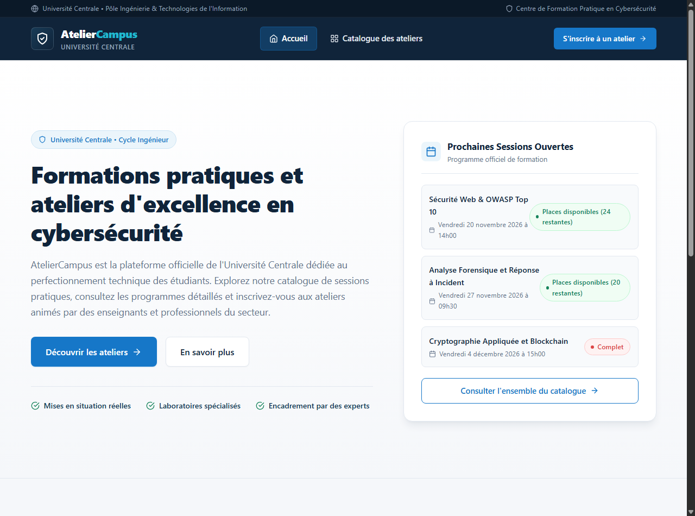

---

### Capture 2 — Catalogue des Ateliers (`02_catalogue.png`)
*URL : `http://localhost:8080/AtelierCampus/catalogue.jsp`*  
Affichage des 4 ateliers couvrant les 4 situations requises (deux futurs disponibles, un complet avec badge rouge, un déjà commencé avec statut archivé). Chaque carte intègre des icônes SVG institutionnelles et un bouton menant vers les détails.

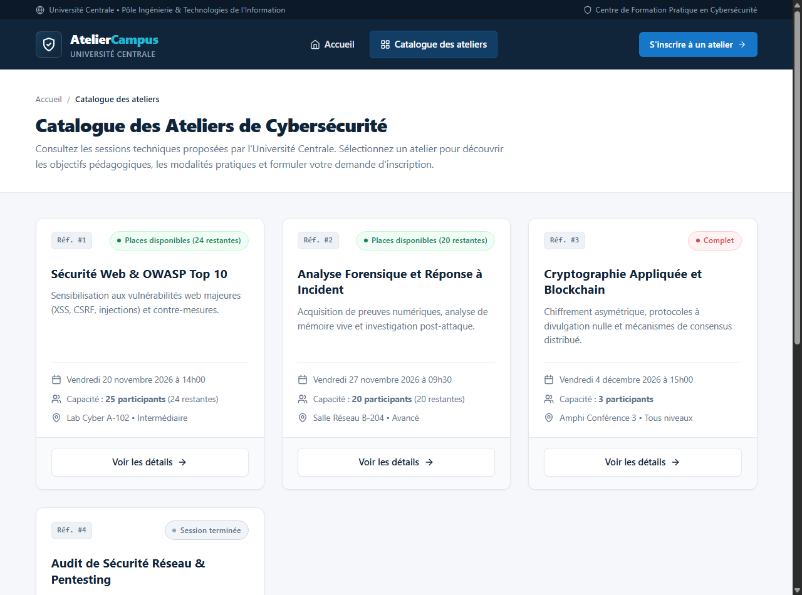

---

### Capture 3 — Détails de l'Atelier Pédagogique (`03_detail_atelier.png`)
*URL : `http://localhost:8080/AtelierCampus/detail.jsp?id=1`*  
La vue détail présente les objectifs, les modalités logistiques (salle, niveau, intervenant), le registre des inscriptions de référence et un panneau latéral sticky avec le bouton « Demander l'inscription ».

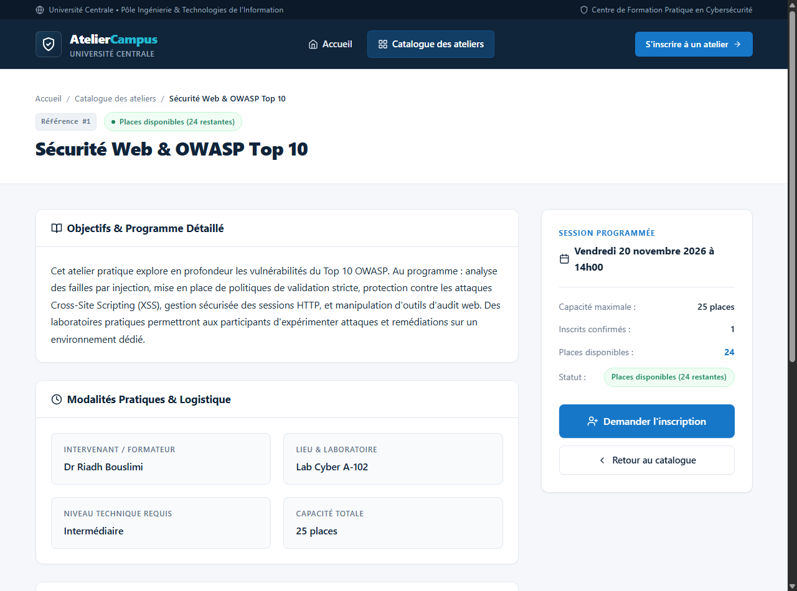

---

### Capture 4 — Formulaire de Demande d'Inscription (`04_formulaire_inscription.png`)
*URL : `http://localhost:8080/AtelierCampus/inscription.jsp?id=1`*  
Le formulaire reprend les informations de l'atelier sélectionné et propose des champs contrôlés pour le nom et l'email avec icônes Lucide intégrées et champ caché `atelierId`.

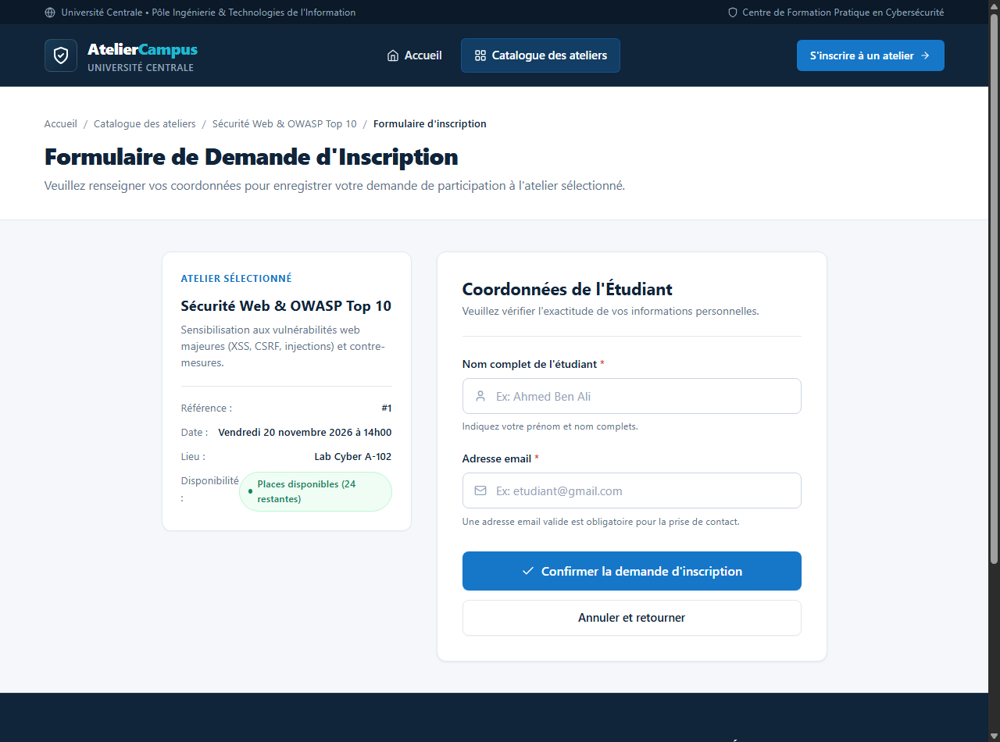

---

### Capture 5 — Gestion Contrôlée d'un Atelier Inexistant (`05_atelier_inconnu.png`)
*URL : `http://localhost:8080/AtelierCampus/detail.jsp?id=9999`*  
En cas d'identifiant inconnu ou malformé, l'application n'affiche aucune erreur technique 500, mais une carte informative invitant l'utilisateur à revenir au catalogue.

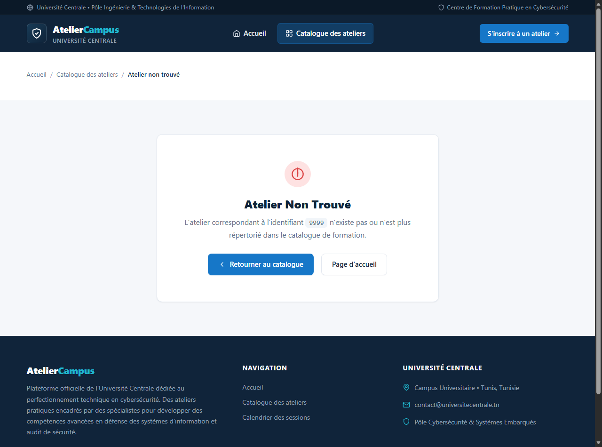

---

### Capture 6 — Sécurisation des Accès Directs (`06_recap_acces_direct.png`)
*URL : `http://localhost:8080/AtelierCampus/recapitulatif.jsp`*  
Si un utilisateur accède à la page récapitulative sans avoir validé de formulaire, le système intercepte la demande et bloque l'affichage de données nulles.

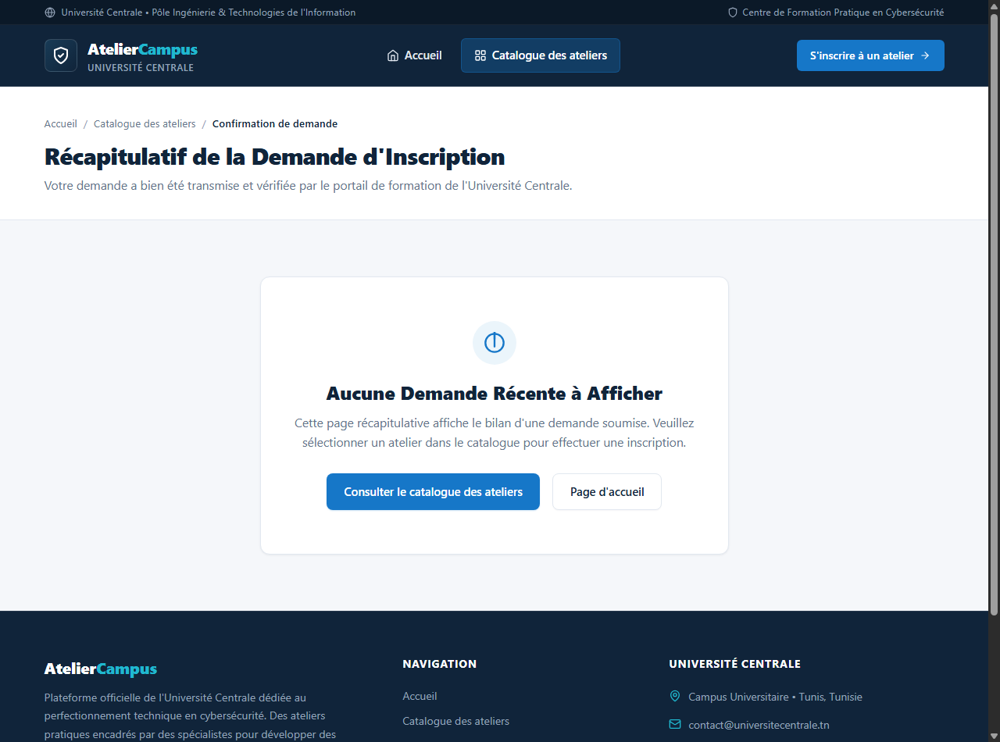

---

### Capture 7 — Réaffichage du Formulaire lors d'une Erreur de Validation (`07_erreur_validation.png`)
*Scénario : Soumission d'un email invalide et d'une tentative d'injection XSS.*  
Le contrôleur côté serveur intercepte l'erreur, réaffiche le formulaire avec un bandeau rouge explicatif, conserve les valeurs saisies et neutralise les balises `<script>`.

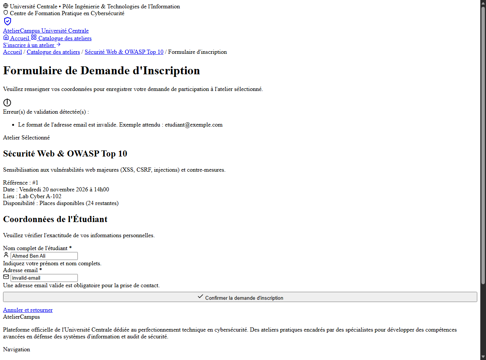

---

### Capture 8 — Récapitulatif avec Mention de Simulation Obligatoire (`08_recapitulatif_simulation.png`)
*Scénario : Soumission valide.*  
Affichage des coordonnées de l'étudiant, de la session choisie et du bandeau institutionnel arborant la mention imposée : **« Demande simulée, non enregistrée. »**

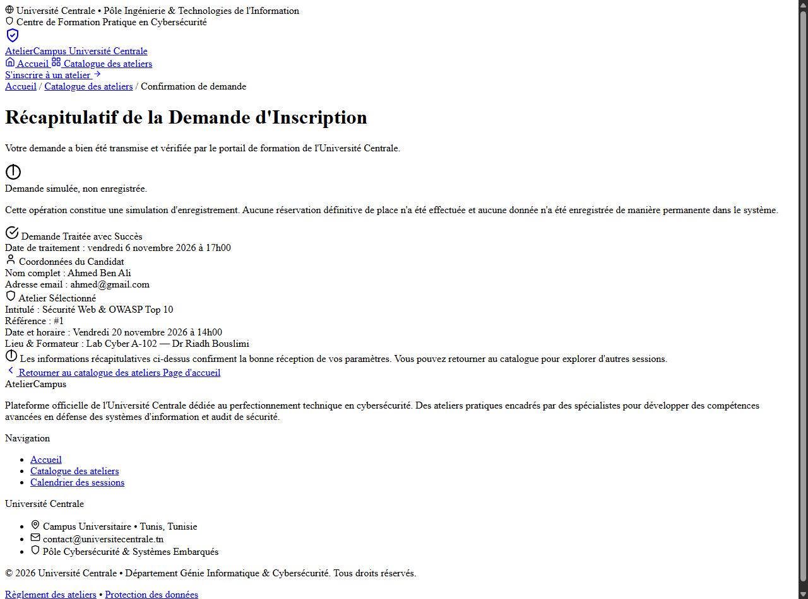

---

## 8. Conclusion & Perspectives vers la Partie 2

La **Partie 1** du projet **AtelierCampus** répond de manière exhaustive à l'ensemble des critères de réussite fixés par le Dr Riadh Bouslimi :
1. **Démarrage et construction sans faille :** Le projet se compile et se package sous Maven via un simple `mvn clean package` et se déploie directement sur Apache Tomcat 10.1.
2. **Architecture logicielle MVC propre :** Séparation nette entre données en mémoire (`DataStore`), contrôleur (`TraitementServlet`) et vues factorisées (`header.jsp`, `footer.jsp`).
3. **Sécurité éprouvée :** Protection systématique contre les injections XSS, validation stricte de toutes les entrées serveur et masquage complet des traces d'erreurs techniques.
4. **Ergonomie institutionnelle :** Refonte visuelle complète respectant l'identité d'un portail universitaire (zéro emoji, 100% SVG, typographies soignées, design responsive).

### Perspectives pour la Partie 2 :
- Mise en place d'une base de données relationnelle MySQL / PostgreSQL avec script de création des tables.
- Remplacement du `DataStore` par des DAO exploitant l'API JDBC et des requêtes `PreparedStatement`.
- Implémentation de la gestion transactionnelle de la capacité et des inscriptions réelles.
- Ajout de l'authentification et du tableau de bord de gestion des ateliers réservé au Gestionnaire.

