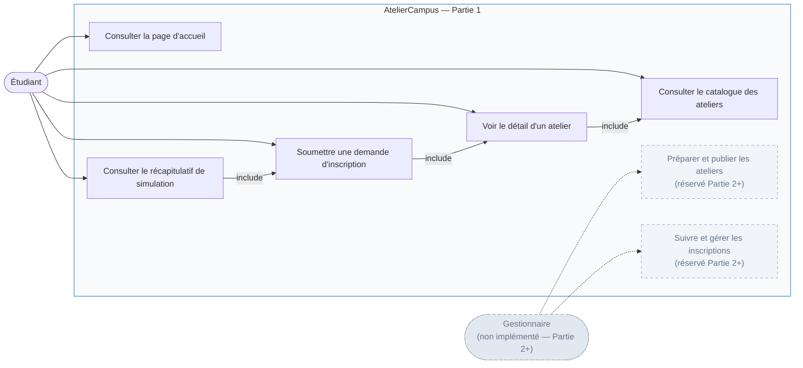
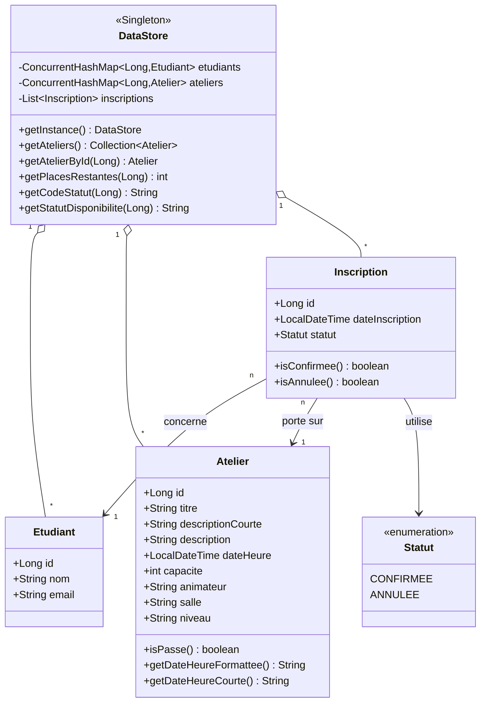
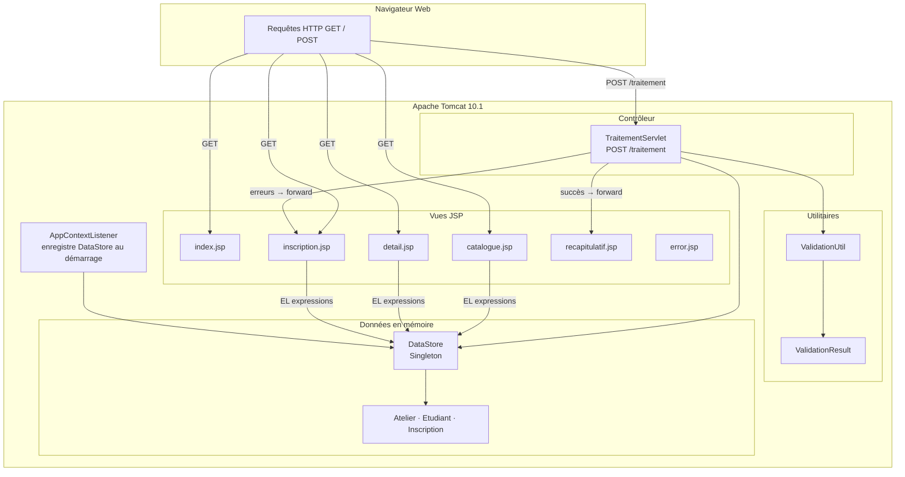
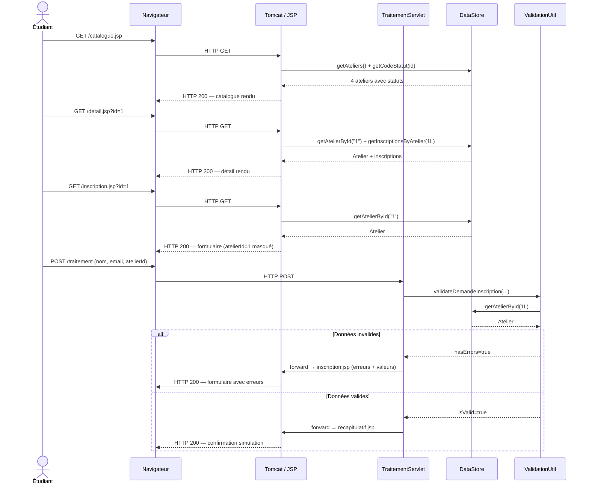

# AtelierCampus — Conception et Architecture Logicielle
**Gestion sécurisée des inscriptions aux ateliers de cybersécurité**
Université Centrale — Développement Jakarta EE — Partie 1

---

## Page 1 — Présentation générale et analyse fonctionnelle

### 1. Introduction

L'Université Centrale organise régulièrement des ateliers de sensibilisation à la cybersécurité destinés à ses étudiants. Face à la multiplication de ces formations, le besoin d'une plateforme numérique centralisée s'est imposé naturellement : un outil permettant aux étudiants de découvrir les sessions disponibles, d'en consulter le contenu détaillé, et de soumettre une demande d'inscription de manière simple et sécurisée.

AtelierCampus répond à ce besoin. Il s'agit d'une application web développée en Jakarta EE, déployée sur Apache Tomcat 10.1, qui constitue la première version fonctionnelle d'un projet évolutif en trois parties. Cette première version repose exclusivement sur des technologies de présentation — JSP, JSTL, Expression Language — et sur des données gérées en mémoire vive, sans recours à une base de données relationnelle. L'objectif est de poser les fondations fonctionnelles et architecturales de la plateforme tout en respectant les contraintes académiques définies pour cette étape du projet.

Le périmètre fonctionnel de la Partie 1 couvre le parcours complet de l'étudiant : consultation de la page d'accueil, exploration du catalogue des ateliers, visualisation du détail d'un atelier, soumission d'un formulaire d'inscription et affichage d'un récapitulatif de confirmation. Les fonctionnalités de gestion réservées aux responsables pédagogiques — authentification, administration des ateliers, suivi des inscriptions — feront l'objet des versions ultérieures.

---

### 2. Objectifs fonctionnels

L'application doit permettre à un étudiant de naviguer librement dans le catalogue des ateliers proposés par l'université. Chaque atelier est présenté sous forme de fiche synthétique affichant son titre, une description succincte, la date et l'heure de la session, la capacité maximale et la disponibilité calculée dynamiquement.

Depuis le catalogue, l'étudiant peut accéder au détail complet d'un atelier : description étendue, informations sur l'animateur et la salle, liste des inscriptions enregistrées et nombre de places restantes. Cette page constitue le point d'entrée naturel vers le formulaire d'inscription.

Le formulaire d'inscription recueille le nom complet et l'adresse email de l'étudiant, ainsi que l'identifiant de l'atelier transmis automatiquement via un champ masqué. L'ensemble des données est soumis au serveur par la méthode HTTP POST et fait l'objet d'une validation rigoureuse côté serveur.

En cas d'erreur de saisie, l'application renvoie l'étudiant vers le formulaire en préservant les valeurs déjà saisies et en affichant des messages d'erreur explicites. En cas de succès, une page de récapitulatif présente le résumé de la demande et rappelle clairement que l'inscription est simulée et non enregistrée de manière persistante.

Enfin, toute erreur applicative — ressource introuvable (HTTP 404) ou erreur interne (HTTP 500) — est interceptée et renvoyée vers une page d'erreur dédiée, sans exposition de trace de pile ni d'informations techniques sensibles.

---

### 3. Identification des acteurs

**Étudiant** : acteur principal de la Partie 1. Il accède à la plateforme sans authentification préalable, consulte le catalogue, visualise les détails des ateliers et soumet des demandes d'inscription.

**Gestionnaire** : acteur identifié dans le contexte fonctionnel global du projet, mais dont les fonctionnalités — gestion des ateliers, suivi des inscriptions, authentification — ne sont pas implémentées dans cette version. Cet acteur sera pris en charge à partir de la Partie 2.

---

### 4. Diagramme de cas d'utilisation



---

## Page 2 — Modélisation des données

### 5. Modèle conceptuel des données

Le modèle de domaine de la Partie 1 repose sur trois entités principales, implémentées sous forme de classes Java dans le package `com.ateliercampus.model`.

**Atelier** représente une session de formation. Il est caractérisé par un identifiant unique (`Long id`), un titre, une description courte destinée aux cartes du catalogue et une description complète pour la page de détail, une date et heure de session (`LocalDateTime dateHeure`), une capacité maximale (`int capacite`), ainsi que des informations complémentaires : animateur, salle et niveau. La méthode `isPasse()` détermine si la session est antérieure à la date courante ; `getDateHeureFormattee()` et `getDateHeureCourte()` produisent des représentations textuelles localisées de la date.

**Etudiant** représente un participant potentiel. Il possède un identifiant, un nom complet et une adresse email. Dans cette version, les étudiants sont pré-chargés en mémoire et ne correspondent pas à des comptes authentifiés.

**Inscription** modélise le lien entre un étudiant et un atelier. Elle porte un identifiant, une date d'inscription (`LocalDateTime dateInscription`) et un statut exprimé par l'énumération interne `Statut`, qui peut prendre la valeur `CONFIRMEE` ou `ANNULEE`. Les méthodes `isConfirmee()` et `isAnnulee()` offrent un accès sémantique à ce statut.



---

### 6. Organisation des données en mémoire

L'absence de base de données dans la Partie 1 est compensée par la classe `DataStore`, implémentée selon le patron de conception Singleton dans le package `com.ateliercampus.data`. Elle constitue l'unique source de données de l'application et est initialisée au démarrage du conteneur.

Les ateliers et les étudiants sont stockés dans des instances de `ConcurrentHashMap<Long, T>`, offrant des accès concurrents sûrs par identifiant sans verrouillage explicite. Les inscriptions sont gérées dans une `ArrayList<Inscription>` protégée par `Collections.synchronizedList`, en raison des parcours itératifs nécessaires aux calculs de statistiques.

Au démarrage de l'application, `DataStore` est initialisé avec **5 étudiants**, **4 ateliers** et **6 inscriptions** représentatives de situations variées : une session complète (atelier #3, capacité 3, 3 inscriptions confirmées), une session passée (atelier #4, date antérieure à aujourd'hui), et une inscription annulée (inscription #2 de Mohamed Trabelsi sur l'atelier #1). Ces jeux de données permettent de démontrer l'ensemble des états gérés par l'application.

L'enregistrement de l'instance `DataStore` dans le `ServletContext` est assuré par `AppContextListener` (annoté `@WebListener`), ce qui rend le singleton accessible dans toutes les pages JSP via l'expression EL `${dataStore}`.

---

## Page 3 — Architecture technique et parcours HTTP

### 7. Architecture technique

L'application adopte une architecture à deux niveaux de présentation. Le traitement du formulaire d'inscription est délégué à un Servlet contrôleur (`TraitementServlet`), conformément au patron MVC. Les autres pages — catalogue, détail, formulaire, récapitulatif — sont des JSP qui accèdent directement à la couche de données via des expressions EL, sans passer par un Servlet intermédiaire. Cette approche est cohérente avec le périmètre de la Partie 1, dans laquelle les JSP assument à la fois le rôle de vue et de contrôleur léger.



Les responsabilités sont réparties comme suit :

| Composant | Rôle |
|---|---|
| `AppContextListener` | Instancie `DataStore` et l'expose dans le `ServletContext` sous la clé `"dataStore"` |
| `TraitementServlet` | Reçoit les soumissions POST, délègue la validation à `ValidationUtil`, puis dispatche vers `inscription.jsp` (erreurs) ou `recapitulatif.jsp` (succès) |
| `ValidationUtil` | Applique les règles de validation et neutralise les caractères HTML dangereux |
| `DataStore` | Fournit l'accès aux données en mémoire et calcule les statuts dynamiques |
| JSP (vues) | Génèrent le HTML en utilisant JSTL et EL pour afficher les données du `DataStore` |
| `includes/header.jsp` | Fragment partagé contenant la navigation et les imports de polices |
| `includes/footer.jsp` | Fragment partagé contenant les informations institutionnelles |
| `error.jsp` | Intercepte les erreurs 404, 500 et toute `java.lang.Throwable` sans exposer de trace de pile |

---

### 8. Organisation du projet

```
AtelierCampus/
├── pom.xml                                    ← Configuration Maven (Jakarta EE 6.0, Java 17)
├── src/
│   ├── main/
│   │   ├── java/com/ateliercampus/
│   │   │   ├── model/
│   │   │   │   ├── Atelier.java               ← Entité atelier (isPasse, formatage date)
│   │   │   │   ├── Etudiant.java              ← Entité étudiant
│   │   │   │   └── Inscription.java           ← Entité inscription (enum Statut)
│   │   │   ├── data/
│   │   │   │   └── DataStore.java             ← Singleton, données initiales, calculs
│   │   │   ├── util/
│   │   │   │   ├── ValidationUtil.java        ← Validation nom/email/atelierId + escapeHtml
│   │   │   │   └── ValidationResult.java      ← Résultat de validation (liste d'erreurs)
│   │   │   └── web/
│   │   │       ├── AppContextListener.java    ← @WebListener, initialise le DataStore
│   │   │       └── TraitementServlet.java     ← @WebServlet("/traitement"), contrôleur POST
│   │   └── webapp/
│   │       ├── index.jsp                      ← Page d'accueil
│   │       ├── catalogue.jsp                  ← Catalogue des ateliers
│   │       ├── detail.jsp                     ← Détail atelier + inscriptions
│   │       ├── inscription.jsp                ← Formulaire d'inscription
│   │       ├── recapitulatif.jsp              ← Récapitulatif de simulation
│   │       ├── traitement.jsp                 ← Thin forwarder JSP vers /traitement
│   │       ├── error.jsp                      ← Page d'erreur unifiée (404/500)
│   │       ├── includes/
│   │       │   ├── header.jsp                 ← En-tête et navigation partagés
│   │       │   └── footer.jsp                 ← Pied de page partagé
│   │       ├── css/
│   │       │   └── style.css                  ← Charte graphique AtelierCampus
│   │       └── WEB-INF/
│   │           └── web.xml                    ← Descripteur Jakarta EE 6.0
│   └── test/
│       └── java/com/ateliercampus/
│           ├── DataStoreTest.java             ← Tests unitaires DataStore (4 tests)
│           ├── ValidationTest.java            ← Tests de validation (15 tests)
│           └── TraitementServletTest.java     ← Tests Servlet avec Mockito (5 tests)
└── documentation/
    └── conception/
        ├── conception-architecture.md         ← Ce document
        └── diagrams/                          ← Diagrammes Mermaid sources
```

---

### 9. Parcours HTTP et navigation

La navigation entre les pages repose sur la transmission de l'identifiant de l'atelier comme paramètre GET, puis sa préservation en tant que champ masqué dans le formulaire POST.

Le parcours nominal débute par l'accès au catalogue (`GET /catalogue.jsp`) qui invoque `${dataStore.ateliers}` et `${dataStore.getCodeStatut(atelier.id)}` pour afficher chaque atelier avec son statut dynamique. L'étudiant clique sur "Voir les détails", ce qui génère une requête `GET /detail.jsp?id=1`. La page de détail récupère l'atelier via `${dataStore.getAtelierById(param.id)}` et affiche les inscriptions associées via `${dataStore.getInscriptionsByAtelier(atelier.id)}`.

Depuis la page de détail, le bouton "S'inscrire" déclenche un `GET /inscription.jsp?id=1`. Le formulaire positionne l'identifiant de l'atelier en champ masqué (`<input type="hidden" name="atelierId" value="${...}">`). La soumission produit un `POST /traitement` avec les paramètres `nom`, `email` et `atelierId`.



La méthode GET sur `/traitement` est délibérément rejetée par le Servlet via une redirection vers `catalogue.jsp`, empêchant tout accès direct à ce point d'entrée. De même, `recapitulatif.jsp` vérifie la présence des attributs de requête attendus et redirige vers le catalogue en leur absence, bloquant les accès directs non autorisés.

---

## Page 4 — Sécurité et limites de la version

### 10. Analyse des menaces et mécanismes de protection

**Injection SQL** — La Partie 1 n'utilise aucune base de données relationnelle. Les données sont entièrement gérées en mémoire via des collections Java, ce qui rend toute injection SQL structurellement impossible dans cette version. Dans la perspective de la Partie 2, l'introduction de JDBC devra obligatoirement s'appuyer sur des requêtes paramétrées (`PreparedStatement`) pour prévenir ce vecteur d'attaque.

**Injection XSS (Cross-Site Scripting)** — L'application applique une protection à deux niveaux. En premier lieu, toutes les valeurs utilisateur affichées dans les JSP sont encapsulées dans des balises JSTL `<c:out value="..."/>`, qui échappent automatiquement les caractères HTML sensibles (`<`, `>`, `&`, `"`, `'`). En second lieu, `ValidationUtil.escapeHtml()` applique le même traitement avant tout réemploi de données dans le circuit de traitement côté serveur, selon le principe de défense en profondeur.

**Accès non autorisé** — Deux mécanismes protègent les points d'entrée sensibles. D'une part, `TraitementServlet.doGet()` intercepte toute requête GET sur `/traitement` et effectue une redirection vers le catalogue, sans traitement ni exposition de données. D'autre part, `recapitulatif.jsp` contrôle la présence des attributs de session nécessaires (`nom`, `email`, `atelier`) et redirige vers le catalogue si l'accès est effectué directement, sans passer par le formulaire.

**Sécurité des cookies de session** — `web.xml` configure le cookie de session avec les attributs `HttpOnly` (inaccessible depuis JavaScript) et `SameSite=Strict` (protection contre les attaques CSRF), avec un mode de suivi exclusivement par cookie.

**Gestion des erreurs** — `web.xml` déclare `error.jsp` comme gestionnaire universel pour les codes HTTP 404 et 500, ainsi que pour `java.lang.Throwable`. Cette page présente un message d'erreur générique sans révéler de trace de pile, de chemin de fichier ou d'information sur l'environnement d'exécution.

---

### 11. Validation des données et gestion des erreurs

La validation est centralisée dans `ValidationUtil.validateDemandeInscription()` et appliquée exclusivement côté serveur, indépendamment de tout contrôle HTML5 côté client.

**Validation du nom** : le champ `nom` est obligatoire, non vide après nettoyage des espaces, d'une longueur comprise entre 2 et 100 caractères. Un nom absent, trop court ou trop long déclenche un message d'erreur en français.

**Validation de l'email** : le champ `email` est obligatoire et doit correspondre à l'expression régulière suivante :
```
^[a-zA-Z0-9_+&*-]+(?:\.[a-zA-Z0-9_+&*-]+)*@(?:[a-zA-Z0-9-]+\.)+[a-zA-Z]{2,7}$
```
La longueur maximale est fixée à 120 caractères.

**Validation de l'identifiant atelier** : le paramètre `atelierId` doit être présent, convertible en `Long`, strictement positif, et correspondre à un atelier existant dans le `DataStore`. Ces quatre contrôles sont appliqués séquentiellement, chacun produisant un message d'erreur distinct.

En cas d'erreur, `TraitementServlet` place la liste des erreurs et les valeurs saisies dans les attributs de la requête, puis transmet (`forward`) vers `inscription.jsp`. Le formulaire ré-affiché présente les erreurs au-dessus des champs concernés et préserve les valeurs saisies pour éviter à l'étudiant de les ressaisir.

---

### 12. Limites de la version et perspectives d'évolution

La Partie 1 remplit son rôle de socle fonctionnel, mais comporte des limites inhérentes à ses contraintes techniques.

**Absence de persistance** : les données en mémoire sont perdues à chaque redémarrage de Tomcat. Aucune inscription soumise via le formulaire n'est réellement enregistrée — le récapitulatif le mentionne explicitement. La transition vers une base de données relationnelle, prévue en Partie 2, apportera la durabilité des données.

**Absence d'authentification** : l'application est entièrement accessible sans identification. Aucun contrôle de rôle n'est implémenté. L'acteur gestionnaire, identifié dans l'analyse fonctionnelle, n'est pas encore opérationnel.

**Vérification de capacité non contraignante** : l'application affiche le statut "Complet" pour un atelier saturé, mais ne bloque pas réellement la soumission d'une nouvelle demande. Cette règle de gestion sera appliquée de manière contraignante en Partie 2.

**Évolution prévue en Partie 2** : introduction d'une base de données MySQL ou PostgreSQL, accès via JDBC avec `PreparedStatement`, remplacement des JSP contrôleurs par des Servlets dédiés, et implémentation de l'authentification du gestionnaire.

**Évolution prévue en Partie 3** : migration vers Spring Boot et JPA/Hibernate, avec une architecture REST et une couche de service découplée.

---

## Captures d'écran de l'application

> Les captures suivantes illustrent l'application déployée sur Apache Tomcat 10.1 en environnement local.

**[CAPTURE D'ÉCRAN 1 — Page d'accueil]**
`screenshots/01_accueil.png`

**[CAPTURE D'ÉCRAN 2 — Catalogue des ateliers]**
`screenshots/02_catalogue.png`

**[CAPTURE D'ÉCRAN 3 — Formulaire d'inscription]**
`screenshots/04_formulaire_inscription.png`

**[CAPTURE D'ÉCRAN 4 — Récapitulatif de simulation]**
`screenshots/08_recapitulatif_simulation.png`

---

## Synthèse des technologies employées

| Couche | Technologie | Version |
|---|---|---|
| Langage | Java | 17 (LTS) |
| Conteneur | Apache Tomcat | 10.1.61 |
| API Servlet | Jakarta Servlet | 6.0 |
| Pages JSP | Jakarta Server Pages | 3.1 |
| Tags JSTL | Jakarta Standard Tag Library | 3.0 |
| Construction | Apache Maven | 3.9+ |
| Tests unitaires | JUnit 5 + Mockito + AssertJ | 5.10 / 5.11 / 3.25 |
| Namespace | `jakarta.*` (jamais `javax.*`) | — |

---

*Document produit dans le cadre du projet AtelierCampus — Développement Jakarta EE — Université Centrale.*

